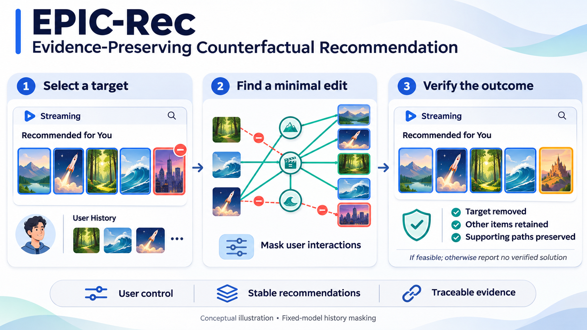

# EPIC-Rec

### Evidence-Preserving Counterfactual Explanations for Top-K Graph Recommendation

**Remove one unwanted recommendation. Preserve the other items and their supporting evidence.**

EPIC-Rec searches for the smallest permitted change to a user's interaction history that removes a selected recommendation while keeping the remaining top-K items and at least one qualifying evidence path for each of them.



*Conceptual illustration of fixed-model history masking. A successful result must pass all requested checks; some requests have no feasible solution, and others remain unresolved within the search budget.*

> **Research question:** Which of my past interactions would need to be absent for this item to stop being recommended, while the other recommendations and their evidence remain?

## How it works

| Step | What EPIC-Rec does | What the user receives |
| --- | --- | --- |
| **1. Select a target** | Takes a user, their original top-K list and one unwanted item. | A clearly defined recommendation to explain or change. |
| **2. Find a minimal edit** | Searches over permitted interactions in that user's history, using exact optimization or approximate search. | A candidate set of interactions to mask. |
| **3. Verify the outcome** | Recomputes scores and rankings and checks the requested preservation constraints. | A verified explanation, a solver-reported infeasibility result for the specified formulation, or an unresolved outcome. |

The model weights remain fixed. Masking is a counterfactual input change; it does not delete the user's stored history or simulate retraining.

## Why preservation matters

Removing a target recommendation can also displace other items or erase the paths that supported them. EPIC-Rec makes these side effects explicit constraints.

- **User control:** investigate how to remove one unwanted suggestion while retaining the others.
- **Stable recommendations:** preserve membership of the remaining list; their order may change.
- **Traceable evidence:** retain a qualifying original path for every preserved item.
- **Auditable limits:** distinguish verified solutions, solver-reported infeasibility and unsuccessful searches.

These are technical capabilities and intended applications. Improvements in user trust, satisfaction, engagement or conversion require separate user or online studies.

## The three constraints

For user `u`, history `H_u`, original top-K list `L_u` and target `t`, find a minimum mask `M ⊆ D_u(t) ⊆ H_u`:

| Constraint | Requirement |
| --- | --- |
| **C1: Target removal** | The target is absent from the recomputed top-K list. |
| **C2: List preservation** | All other original top-K items remain. Exactly one new item fills the target's place. |
| **C3: Evidence preservation** | Each retained item keeps at least one qualifying original, score-contributing evidence path. |

`D_u(t)` restricts the mask to interactions supporting the target. Other users' interactions and knowledge-graph facts are not editable.

On the additive path scorer, a surviving path has a fixed contribution. Evidence thresholds use `τ_j = max(α × strongest original path contribution, φ)`, with the configured score-drop check. Interpret evidence survival together with these thresholds; it is a statement about the model's computation, not a causal claim about the user's preferences.

| Setting | Constraints | Purpose |
| --- | --- | --- |
| A | C1 | Remove the target. |
| B | C1 + C2 | Also preserve the remaining list. |
| C | C1 + C2 + C3 | Also preserve qualifying evidence. |
| A3 | C1 + C3 | Measure evidence preservation without enforcing list preservation. |

### Scope of exactness

The MILP solves the margin formulation `P_ε` on the specified mask domain, with default `ε = 1e-6`. Returned masks are also checked against the original ranking rule, with item-ID tie-breaking.

- An **optimal** result establishes a minimum under the solver's formulation and numerical settings.
- A **feasible** result provides a verified mask without established minimum size.
- An **infeasible** result applies to `P_ε` and `D_u(t)`; it does not automatically prove infeasibility for the original problem `P` or unrestricted history edits.
- A **timeout** or approximate **not_found** result does not establish infeasibility.

Rechecking a result with another configuration of the same solver is a numerical cross-check, not an independently verified mathematical certificate. Formal definitions and implementation details: [Method](docs/method.md).

## Installation

Requires Python 3.10 or later. The supplied workflow runs on CPU.

```bash
git clone https://github.com/MehrdadJalali-AI/EPIC-Rec.git
cd EPIC-Rec
python -m venv .venv
source .venv/bin/activate
pip install -r requirements.txt
pip install -e ".[dev,prince]"
```

On Windows, activate the environment with `.venv\Scripts\activate`.

The supplied environment pins `highspy` to 1.15.1. See [Reproducibility](docs/reproducibility.md) for solver settings and environment details.

## Quick start

Run a synthetic demonstration before downloading research datasets:

```bash
epic-rec demo
pytest -q -m "not network"
bash scripts/run_smoke.sh
```

Prepare MovieLens and explain a recommendation:

```bash
epic-rec download movielens-1m
epic-rec prepare --config configs/movielens.yaml
epic-rec train --config configs/movielens.yaml
epic-rec explain --config configs/movielens.yaml --user 42 --rank 1 --setting A B C --out explanation.json
```

Use a valid user ID from the processed dataset; `42` is an example.

### Python example

```python
from epic_rec.data import load_or_prepare
from epic_rec.experiments import load_model
from epic_rec.explainers import explain
from epic_rec.optimization import ExplanationInstance
from epic_rec.utils.config import load_config

cfg = load_config("configs/movielens.yaml")
model = load_model(cfg, load_or_prepare(cfg))

inst = ExplanationInstance(model, u=42, K=10, alpha=0.5)
inst.set_target(int(inst.L[0]))

explanation = explain(inst, "C", "exact")
print(explanation.summary())
```

## Understanding an explanation

A successful setting-C explanation can be read as:

> “Without these interactions, the selected item would leave your top-K recommendations. The other original items would remain, each with at least one qualifying original evidence path.”

The JSON output records the request, method, status, masked interaction IDs, success flag and verification details. Verification includes the updated list, replacement item where applicable, list overlap, retained-item rank correlation and surviving evidence paths.

Interpret statuses before interpreting the mask. Exact methods use `optimal`, `feasible`, `infeasible` or `timeout`; approximate methods use `found` or `not_found`. A bound may be available without a proven optimum. A diagnostic explanation of failure should not be treated as a complete infeasibility proof unless established by the method.

See the [results schema](docs/results_schema.md) for field definitions.

## Datasets

| Dataset | Interaction source | Knowledge-graph source | Role |
| --- | --- | --- | --- |
| MovieLens-1M | GroupLens | Satori linkage from RippleNet | Main evaluation |
| Last.fm / HetRec 2011 | GroupLens | Satori linkage from KGCN | Cross-domain evaluation |
| Amazon-Book | KGAT release | Freebase-based KG from the release | Optional larger dataset; not evidence of completed evaluation |
| Synthetic | Generated | Generated | Tests, CI and demonstration |

Raw research datasets are not redistributed. Consult [Data preparation](docs/data.md) for source versions, licensing, checksums, filters, seeded 70/10/20 splits and leakage checks. Dataset manifests should accompany the processed outputs used in each experiment.

## Experiments

Experiment configurations live in `configs/experiments/`. A configuration specifies an experiment; it does not by itself establish that the experiment has been completed.

| Configuration | Question |
| --- | --- |
| `movielens_main.yaml`, `lastfm_main.yaml` | Feasibility and mask size for A, B, C and A3; exact and approximate methods |
| `movielens_k_sweep.yaml` | Effect of K = 5, 10, 20 |
| `movielens_threshold.yaml` | Effect of α = 0.25, 0.5, 0.75, 1.0 |
| `movielens_margin.yaml` | Effect of ε; comparison of P and P_ε by enumeration on small instances |
| `movielens_ablations.yaml` | Constraint, repair and initialization ablations |
| `movielens_prince.yaml`, `lastfm_prince.yaml` | PRINCE on its native PageRank recommender |
| `smoke.yaml` | Small synthetic pipeline check |

```bash
epic-rec run --config configs/experiments/movielens_main.yaml
epic-rec report results/movielens-1m results/lastfm --out results/report
epic-rec pipeline --config configs/experiments/pipeline_full.yaml
```

Set `EPIC_WORKERS=8` to request parallel workers. Configuration overrides use `--set`, for example:

```bash
epic-rec run --config configs/experiments/movielens_main.yaml --set experiment.time_limit=5 --set experiment.users_per_stratum=10
```

### Results and reporting

| Output | Contents |
| --- | --- |
| `results/<dataset>/accuracy.{json,csv}` | Recall and NDCG for the recommender and accuracy baselines |
| `results/<dataset>/<experiment>/records.jsonl` | Per-instance outcomes, configurations and verification records |
| `results/report/tables/` | Feasibility, mask sizes, paired costs, evidence, runtime and sensitivity tables |
| `results/report/figures/` | Figures generated from the saved records |

Reports should state their denominator, sample size and filtering conditions. The evaluation uses 95% user-level stratified cluster-bootstrap intervals, keeping targets from the same user together. Conditional success among successful target removals must be distinguished from success across all evaluated pairs.

## Methods and comparisons

EPIC-Rec includes MILP optimization with HiGHS and approximate searches using greedy orders, beam search and continuous masks with sigmoid or Gumbel relaxation. Random and popularity orders provide controls.

The in-house methods are distinct from published explainers. The supplied baseline setup includes an adapter for official PRINCE code on its native recommender; comparisons across different recommenders must be interpreted separately from comparisons on a common backbone. Consult [Baseline documentation](docs/baselines.md) for execution status, source versions, adaptations and limitations involving ACCENT, GREASE, CoSRec and CF-GNNExplainer. Only completed, verified runs support empirical claims.

## Reproducibility

Use the recorded configurations, seeds, dependency versions, checksums and dataset manifests when reproducing a result. Preserve per-instance records and identify the repository commit associated with published tables and figures.

Runtime reporting should include model construction, optimization, constraint generation, verification and any additional solver cross-checks. A configured solver limit is not necessarily a hard limit on the full pipeline.

See [Reproducibility](docs/reproducibility.md) for worker seeding, resumable runs, solver settings and validation procedures.

## Limitations

- The exact formulation relies on an additive path scorer and frozen normalization. Other architectures require a suitable evidence definition and a different or approximate solution method.
- Counterfactuals describe the fixed model's response to masking; they do not establish the outcome of retraining or real-world causal effects.
- C2 preserves list membership, not necessarily ranks, scores or recommendation quality.
- Feasibility depends on the mask domain, score margin and evidence thresholds.
- Large instances may exceed the search budget. A verified feasible solution can still be useful even when its minimality is unresolved.
- The workflow illustration is conceptual. It does not represent measured performance or an experimentally verified case study.
- The reported research is offline; deployment and business outcomes need further evaluation.

## Responsible use

Explanations can expose sensitive interaction history. Use them for the user concerned or for authorized audits with appropriate access controls. Counterfactual masking is not data erasure, machine unlearning or a privacy guarantee.

Dataset access and reuse remain subject to the original distributors' terms. A product interface should distinguish hypothetical edits from changes actually applied to a user's account. See [Product perspective](docs/commercial.md).

## Citation

Use [CITATION.cff](CITATION.cff) for release-specific citation metadata. The software citation supplied with this project is:

```bibtex
@software{jalali_epic_rec,
  author = {Jalali, Mehrdad},
  title  = {{EPIC-Rec}: Evidence-Preserving Counterfactual Explanations for Top-{K} Graph Recommendation},
  url    = {https://github.com/MehrdadJalali-AI/EPIC-Rec},
  year   = {2026}
}
```

## License

Project code: MIT, as specified in [LICENSE](LICENSE). Datasets and third-party implementations retain their own licenses; see [data](docs/data.md) and [baseline](docs/baselines.md) documentation.
