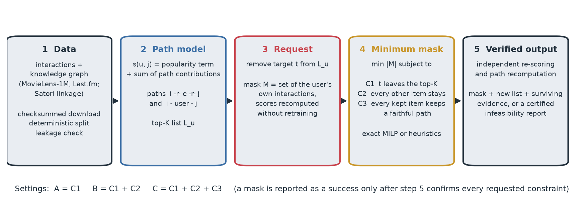

# EPIC-Rec: Evidence-Preserving Counterfactual Explanations for Top-K Graph Recommendation

EPIC-Rec answers a concrete question about a recommendation list:

> **What is the smallest set of a user's own past interactions that would have to be absent for one recommended
> item to leave the top-K list — while every other recommended item stays, and keeps the evidence that supports
> it?**

It computes the answer exactly (mixed-integer programming with HiGHS) or approximately (greedy, beam and
continuous-mask search), verifies every answer independently, and certifies when no such answer exists.



## Motivation

Counterfactual explanations for recommenders usually ask what would make the top item change. In a deployed
system, the more useful question is often narrower: a user wants one item gone, and the rest of the list — and
the reasons shown for it — should not be disturbed. Removing the target alone (C1) can push other good items out
of the list, and can delete the only evidence behind items that stay. EPIC-Rec makes these side effects explicit
constraints and measures how often they can be satisfied, at what cost, and why they sometimes cannot.

## Problem

For user `u` with history `H_u`, top-K list `L_u` and target `t ∈ L_u`, find a minimum mask `M ⊆ D_u(t) ⊆ H_u`
(only the user's own interactions may be masked; scores are recomputed without retraining) such that

* **C1 — target removal:** `t` is not in the top-K list after masking;
* **C2 — list preservation:** every other item of `L_u` is still in the top-K list (one new item takes the
  freed slot);
* **C3 — evidence preservation:** every retained item keeps at least one qualifying, faithful evidence path
  (a path whose contribution is at least `τ_j = max(α · strongest path, φ)` and whose removal lowers the item's
  score by at least `φ`).

| setting | constraints |
| --- | --- |
| A | C1 |
| B | C1 + C2 |
| C | C1 + C2 + C3 |
| A3 (ablation without C2) | C1 + C3 |

All orderings must hold with a configurable score margin `ε` (problem P_ε, default `1e-6`); every reported mask
is also checked under exact ranking with id tie-break. The formal definitions, the MILP, the proofs behind its
pruning rule and the approximate methods are in [docs/method.md](docs/method.md).

## Installation

```bash
git clone https://github.com/MehrdadJalali-AI/EPIC-Rec.git && cd EPIC-Rec
python -m venv .venv && source .venv/bin/activate          # Python >= 3.10
pip install -r requirements.txt && pip install -e ".[dev,prince]"
```

CPU only. `highspy` is pinned to 1.15.1 (see [docs/reproducibility.md](docs/reproducibility.md)).

## Quick start

```bash
epic-rec demo                       # synthetic data, seconds: trains a model, explains two targets under A, B, C
pytest -q -m "not network"          # unit, regression and pipeline tests
bash scripts/run_smoke.sh           # tests + demo + smoke experiment + report on synthetic data
```

Explain one recommendation on real data:

```bash
epic-rec download movielens-1m
epic-rec prepare --config configs/movielens.yaml
epic-rec train   --config configs/movielens.yaml          # backbone + accuracy baselines
epic-rec explain --config configs/movielens.yaml --user 42 --rank 1 --setting A B C --out explanation.json
```

From Python:

```python
from epic_rec.data import load_or_prepare
from epic_rec.experiments import load_model
from epic_rec.explainers import explain
from epic_rec.optimization import ExplanationInstance
from epic_rec.utils.config import load_config

cfg = load_config("configs/movielens.yaml")
model = load_model(cfg, load_or_prepare(cfg))
inst = ExplanationInstance(model, u=42, K=10, alpha=0.5)
inst.set_target(int(inst.L[0]))                 # explain the removal of the rank-1 item
e = explain(inst, "C", "exact")                 # or "beam", "greedy:violation", "continuous"
print(e.summary())
```

## Datasets

| dataset | interactions | knowledge graph | role |
| --- | --- | --- | --- |
| MovieLens-1M | GroupLens | Microsoft Satori (RippleNet release) | main |
| Last.fm (HetRec 2011) | GroupLens | Microsoft Satori (KGCN release) | second dataset |
| Amazon-Book | KGAT release | Freebase (KB4Rec, KGAT release) | optional, larger |
| synthetic | generated | generated | tests, CI, demo |

No data are committed. `epic-rec download` fetches the files from their distributors at pinned commits and refuses
any file whose SHA-256 differs from the recorded value. Filters, splits (70 / 10 / 20 per user, seeded) and
leakage checks are documented in [docs/data.md](docs/data.md) and recorded in each processed dataset's manifest.

## Experiments

Every experiment is a YAML config in `configs/experiments/`; runs are parallel, resumable and write one JSON line
per (user, target, configuration, setting, method).

| config | question |
| --- | --- |
| `movielens_main.yaml`, `lastfm_main.yaml` | feasibility and minimum mask size for A, B, C and A3; exact versus every approximate method |
| `movielens_k_sweep.yaml` | K = 5, 10, 20 |
| `movielens_threshold.yaml` | evidence threshold α ∈ {0.25, 0.5, 0.75, 1.0} |
| `movielens_margin.yaml` | score margin ε ∈ {1e-8, 1e-6, 1e-4}; P versus P_ε by enumeration |
| `movielens_ablations.yaml` | without C2 (A3), without C3 (B), without repair, random versus learned initialisation |
| `movielens_prince.yaml`, `lastfm_prince.yaml` | PRINCE (official code) on its native PageRank recommender |
| `smoke.yaml` | everything above in miniature, on synthetic data |

```bash
epic-rec run    --config configs/experiments/movielens_main.yaml      # EPIC_WORKERS=8 to parallelise
epic-rec report results/movielens-1m results/lastfm --out results/report
epic-rec pipeline --config configs/experiments/pipeline_full.yaml     # everything: train, run, report
```

Any config key can be overridden: `--set experiment.time_limit=5 --set experiment.users_per_stratum=10`.

## Output

```
results/<dataset>/accuracy.{json,csv}          Recall@10/20, NDCG@10/20 of the backbone and baselines
results/<dataset>/<experiment>/records.jsonl   all outcomes (schema: docs/results_schema.md)
results/report/tables/*.csv                    feasibility by setting / rank / history / entanglement, mask sizes,
                                               paired size differences, exact vs approximate, evidence survival,
                                               runtime, P vs P_eps, infeasibility causes, cross-dataset
results/report/figures/*.{pdf,png}             the corresponding figures
```

Every table and figure is generated from the saved records; confidence intervals are 95 % user-level stratified
cluster-bootstrap intervals, and every table states its numbers of pairs and users.

## Reading an explanation

An `Explanation` (JSON via `--out`) contains the request (`user`, `target`, `rank`, `K`, `setting`), the solver
`status` (`optimal`, `feasible` with a proven bound, `infeasible`, `timeout`; approximate methods `found` /
`not_found`), the `mask` (item ids from the user's history), `success`, and a `verification` report: the new list,
which item entered, list overlap, rank correlation of retained items, and for each retained item its surviving
evidence paths with faithfulness checks. Read it as: *"without these interactions, the target would not be
recommended; the other items would remain, each still supported by the listed paths."* For infeasible requests,
`infeasibility` names the cause (for example, the target and a retained item depend on the same interactions).
Field-by-field documentation: [docs/results_schema.md](docs/results_schema.md).

## Baselines

In-house explainers (greedy variants, beam search, continuous masks with sigmoid or Gumbel relaxation, random and
popularity controls) are named after what they do. Published methods are run only from their official code:
PRINCE is run through an adapter on its native recommender; ACCENT, GREASE, CoSRec and CF-GNNExplainer could not
be compared reliably, for reasons documented in [docs/baselines.md](docs/baselines.md). No result is reported for
a method that was not run.

## Reproducibility

Seeds are derived per purpose and per user, so results do not depend on the number of workers; downloads and
processed data carry checksums and manifests; runs resume after interruption; every exact solve has a hard
time limit. Details: [docs/reproducibility.md](docs/reproducibility.md).

## Limitations

* The guarantees are for the path-additive recommender, whose scores decompose exactly into paths. Models without
  such a decomposition (matrix factorisation, most GNNs) can be explained only approximately; C3 is then not
  well defined.
* Masks are counterfactual inputs to the deployed model (no retraining). They describe the model's dependence on
  the history, not what a retrained model would do.
* Exact solving is NP-hard in general; long histories or large K can hit the time limit. Such cases are reported
  as `feasible` (with a bound) or `timeout`, never as solved.
* Evidence is defined by thresholds (`α`, `φ`); conclusions about C3 should be read together with the threshold
  sensitivity experiment.
* Results are offline. Effects on user satisfaction or business metrics need online studies.

## Ethics and responsible use

Explanations reveal which past interactions drive a recommendation. They are meant for the user concerned or for
audits under appropriate access control, not for inferring sensitive attributes. The public datasets used here are
anonymised research datasets distributed under their own terms; this repository does not redistribute them.
Masks are hypothetical: EPIC-Rec never deletes data. A product feature built on it should make clear that an
explanation describes the model's behaviour, not a judgement about the user. See also
[docs/commercial.md](docs/commercial.md) for the product perspective.

## Citation

If you use this code, please cite it (see [CITATION.cff](CITATION.cff)):

```bibtex
@software{jalali_epic_rec,
  author = {Jalali, Mehrdad},
  title  = {{EPIC-Rec}: Evidence-Preserving Counterfactual Explanations for Top-{K} Graph Recommendation},
  url    = {https://github.com/MehrdadJalali-AI/EPIC-Rec},
  year   = {2026}
}
```

## Licence

Code: MIT ([LICENSE](LICENSE)). Datasets and third-party code remain under their own licences (see
[docs/data.md](docs/data.md) and [docs/baselines.md](docs/baselines.md)).
